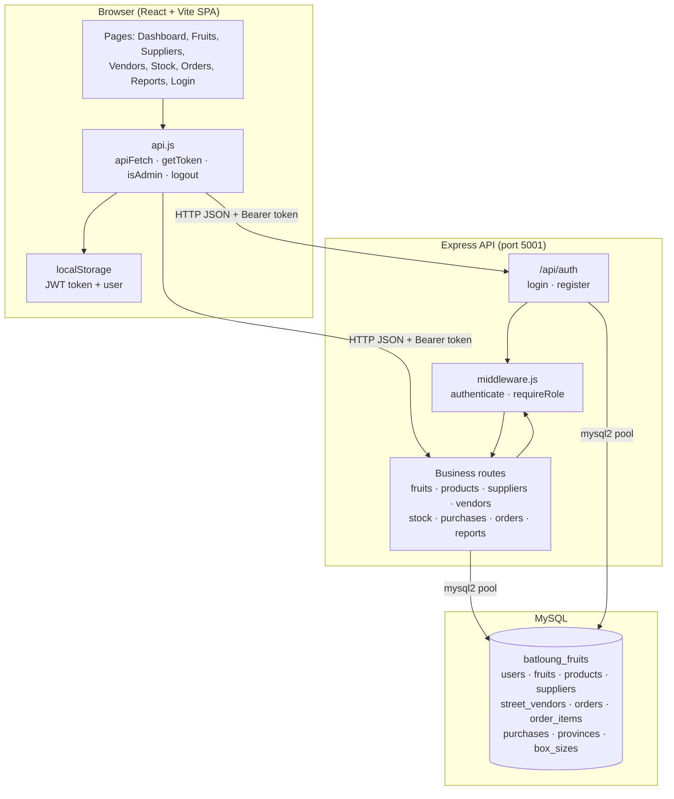
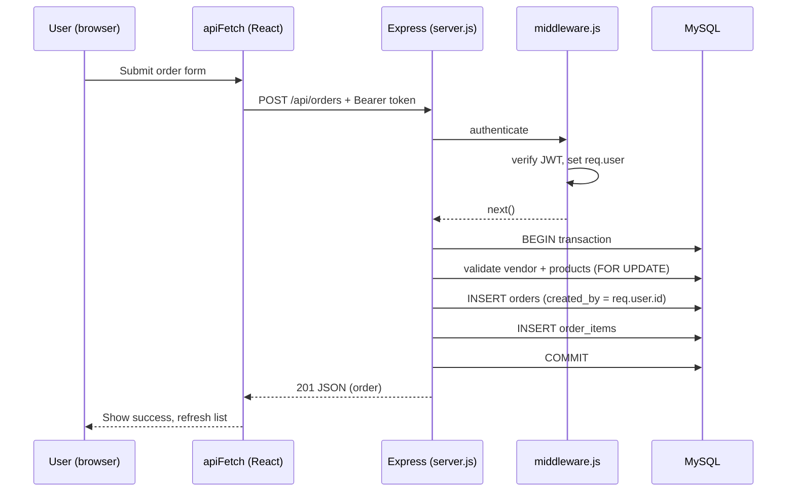

# Architecture

The Batloung Fruits Distribution Management System is a three-tier web application: a React single-page app, an Express REST API, and a MySQL database.

## System diagram

## Layers

### 1. Frontend (React + Vite)

- Entry point `src/main.jsx` renders `src/App.jsx`, which defines the routes with `react-router-dom`.
- `src/api.js` centralizes all HTTP calls. `apiFetch` attaches the `Authorization: Bearer <token>` header, and on a `401` it clears the session with `logout()`.
- `RequireAuth` in `src/App.jsx` wraps protected routes; unauthenticated users are redirected to `/login`.
- `isAdmin()` gates administrator-only controls in the UI. The server enforces the same rules, so hiding a button is convenience, not security.
- State is local component state via `useState`/`useEffect`; there is no global state library.

### 2. Backend (Express + mysql2)

- `server/server.js` creates the Express app, enables CORS and JSON parsing, and mounts the routers.
- `server/auth.js` handles `/api/auth/login` (bcrypt compare + JWT issue) and `/api/auth/register` (administrator only).
- `server/middleware.js`:
  - `authenticate` verifies the JWT and sets `req.user`.
  - `requireRole(...roles)` restricts an endpoint to specific roles.
- Public routes: `GET /api/health` and `/api/auth/*`. All other `/api` routes pass through `authenticate`.
- Order creation and completion use database transactions so stock changes and order rows stay consistent. Completing an order deducts stock; cancelling restores it.
- `/api/orders` inserts `created_by` from the logged-in user for auditing.

### 3. Database (MySQL)

- Schema and constraints live in `server/database.sql` (source of truth).
- Reference/lookup data (provinces, box sizes) is in `server/initial_reference_data.sql` using `INSERT IGNORE`.
- See `ERD.md` for the entity-relationship diagram and the relationship overview.

## Request lifecycle (example: creating an order)

## Security

- Passwords are hashed with bcrypt; plain passwords are never stored.
- Sessions use signed JWTs with a 24-hour expiry, signed with `JWT_SECRET` from `.env`.
- Secrets (`DB_PASSWORD`, `JWT_SECRET`) stay in `.env`, which is excluded from version control via `.gitignore`. `.env.example` documents the variables.
- Role checks are enforced server-side with `requireRole`.

## Configuration

| Variable | Purpose |
| --- | --- |
| `DB_HOST` | MySQL host (default `localhost`) |
| `DB_USER` | MySQL user |
| `DB_PASSWORD` | MySQL password |
| `DB_NAME` | Database name (`batloung_fruits`) |
| `PORT` | API port (default `5001`) |
| `JWT_SECRET` | Secret used to sign and verify login tokens |
